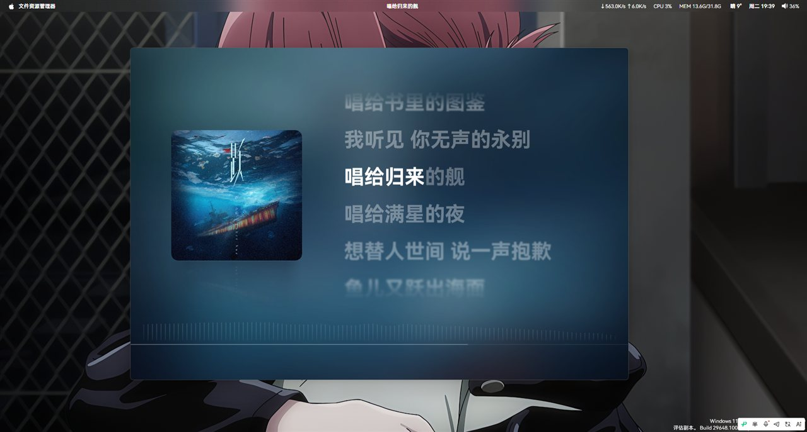
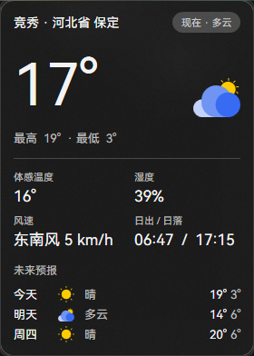

# MyTopBar

Windows 上的 macOS 风格顶栏。通过 Shell 的 AppBar 协议真正占用桌面工作区，最大化窗口从顶栏下边缘开始。


## 特性

- **工作区占位**：注册为 AppBar，最大化窗口不会盖住顶栏
- **亚克力毛玻璃**：基于 FluentWpfCore 的 Acrylic 合成层，支持浅色 / 深色主题与 5 档通透感即时调节
- **字体可定制**：内嵌 HarmonyOS Sans SC（5 档字重），支持实时切换任意系统字体与字号
- **可插拔组件**：中区与右区独立装配，可启停、可拖动排序
- **不抢焦点**：点击顶栏不会让当前窗口失焦
- **便携**：配置存在程序目录 `settings.json`，不写 `%AppData%`
- **全屏自动收起**：有全屏应用时隐藏，退出后恢复

## 预览


<details>
<summary>更多截图</summary>



歌词跟随系统媒体会话（SMTC），播放时替换文本组件；点击可弹出播放控制浮窗。



点击天气弹出详情卡片：实时温度、体感/湿度/风速、日出日落与未来 3 天预报。

</details>

## 组件

| 组件 | 区域 | 数据来源 | 说明 |
|---|---|---|---|
| 歌词 | 中 | SMTC + 网易云 / [LRCLIB](https://lrclib.net) | 有播放时显示，与文本互斥；点击弹播放控制 |
| 文本 | 中 | 静态文本 / [一言](https://hitokoto.cn) | 无播放时显示 |
| 网络 | 右 | `NetworkInterface` | 上下行实时速率 |
| CPU | 右 | `GetSystemTimes` | 采样差值计算使用率 |
| 内存 | 右 | `GlobalMemoryStatusEx` | 已用 / 总量 |
| 天气 | 右 | 和风天气 | 彩色矢量图标；点击弹详情卡片 |
| 时钟 | 右 | 本地时间 | 整分刷新；点击弹日历 |

系统指标由单一定时器统一采样供各组件共享。图标全部使用矢量图形（`DrawingImage` / `Path`），不用 emoji——Windows 的 emoji 字体在深色背景下会被渲染成单色轮廓。

## 交互

- **Apple 图标** → 系统菜单（关于本机 / 系统设置 / 睡眠 / 重启 / 关机 / 退出）
- **时钟** → 日历 · **天气** → 详情卡片 · **歌词** → 播放控制 · **音量** → 音量滑块
- **点击弹窗外部** → 自动收起
- **长按组件 3 秒** → 进入排序模式，拖动换位，松手保存

## 系统要求

Windows 10 1809 (build 17763) 或更高；.NET 8 SDK（仅编译需要）。

## 构建

```bash
git clone https://github.com/KiwiR1der/MyTopBar.git
cd MyTopBar
dotnet build
dotnet run --project MyTopBar
```

产物位于 `MyTopBar/bin/Debug/net8.0-windows10.0.19041.0/MyTopBar.exe`。

## 配置

首次启动在 exe 同级生成 `settings.json`；若该位置无配置而 `%AppData%\MyTopBar\settings.json` 存在，会复制一次过来（旧文件保留）。

```jsonc
{
  "appearance": {
    "theme": 1,          // 1=浅色 2=深色
    "translucency": 1,   // 0=极透 1=通透 2=均衡 3=厚重 4=不透明
    "barHeight": 30,     // 28-40
    "fontFamily": "",    // 空或 "HarmonyOS Sans SC" 使用内置字体，其余为系统字体名
    "fontSizePixels": 13 // 11-16（WPF DIP）
  },
  "widgets": [
    { "id": "clock", "enabled": true, "order": 0, "options": {} }
  ],
  "api": {
    "qWeather": {
      "apiHost": "",            // 控制台-设置，形如 xxx.qweatherapi.com
      "apiKey": "",             // 控制台-项目管理的凭据
      "latitude": "39.92",
      "longitude": "116.41",
      "placeName": "",          // 城市搜索填入，仅用于显示
      "intervalMinutes": 30,
      "language": "zh"
    },
    "hitokoto": { "enabled": true, "intervalMinutes": 30 }
  },
  "metrics": { "intervalMs": 1000 }
}
```

也可以点 Apple 菜单里的「MyTopBar 设置…」用图形界面调整。

### 和风天气

使用新版 API（`X-QW-Api-Key` 请求头认证）：

```
GET https://{ApiHost}/geo/v2/city/lookup?location={城市名}&number=10
GET https://{ApiHost}/weather/v1/current/{lat}/{lon}?lang=zh
GET https://{ApiHost}/weather/v1/daily/{lat}/{lon}?localTime=true&lang=zh&days=3
```

设置窗口里按顺序填：

1. **API Host** —— 控制台 → 设置 → API Host
2. **API Key** —— 控制台 → 项目管理 → 凭据（认证方式选 API KEY）
3. **地点** —— 搜城市名，点结果自动填经纬度
4. 点 **应用并测试** 立即请求一次校验

> 常见错误：把「凭据 ID」（形如 `ABCDE12345`）当成 API Host 填入。两者不同，凭据 ID 只在 JWT 认证时作为 `kid` 使用。

参数改完必须点「应用并测试」才生效，输入过程中不会反复请求接口——天气接口按次计费。

用 API KEY 而非官方推荐的 JWT，原因：.NET 8 无内置 Ed25519，需引入第三方库；且桌面应用把私钥存进配置文件，反而比一个可随时吊销的 Key 更危险。

## 实现要点

<details>
<summary>展开查看</summary>

### 工作区占位

`AppBarController` 通过 `SHAppBarMessage`（`ABM_NEW` / `ABM_QUERYPOS` / `ABM_SETPOS`）注册应用栏，并处理 `ABN_POSCHANGED` 重定位、`TaskbarCreated` 广播（Explorer 重启后重新注册）、`WM_DPICHANGED` / `WM_DISPLAYCHANGE` 按新 DPI 重算厚度。

### 不抢焦点

顶栏加 `WS_EX_NOACTIVATE | WS_EX_TOOLWINDOW`，配合 `ShowActivated="False"`，点击时前台窗口保持不变。代价是永远拿不到键盘焦点，所以排序模式的 Esc 退出改用临时的 `WH_KEYBOARD_LL` 钩子（平时不挂任何全局钩子）。

### 弹窗

7 个弹窗是独立 `Window`（`PopupWindow`）而非 WPF `Popup`——后者位置依赖 `PlacementTarget`，无法精确控制。

- 弹窗自身带 `WS_EX_NOACTIVATE`，从设计上不抢焦点。若做成可激活窗口，`Show()` + `Activate()` 会被前台锁规则静默拒绝，弹窗虽画出来却不是活动窗口，点击会**穿透到菜单下方的程序**
- 收起不靠 `Deactivated`（非激活窗口收不到），而是打开期间临时挂 `WH_MOUSE_LL` 钩子：点外部收起，点自身放行
- 用 `Hide()` 而非 `Close()`：`Close()` 销毁 HWND，之后 `Show()` 抛异常
- 右区弹窗对齐「显示器右边缘 - 20」而非 `RightPanel`——后者在 `SharedSizeGroup` 列里宽度会变，拿它当基准会导致每次打开位置不同

### 全屏应用

`ABN_FULLSCREENAPP` 的 `lParam` 非 0 表示进入。用 `Visibility.Hidden` 而非 `Window.Hide()`（后者卸载视觉树，恢复时会闪）；不注销 AppBar（否则退出全屏瞬间工作区会跳一次）；全屏期间忽略 `ABN_POSCHANGED`。

### 数据刷新

所有周期性刷新走单个 `GlobalTickService`（250ms `DispatcherTimer`），各 DataService 按自己的间隔订阅，无订阅者时自动停。只有启动时和点「应用并测试」才真正发网络请求。

### 亚克力毛玻璃

顶栏（`MainWindow`）、7 个弹窗（`PopupWindow`）与设置窗口（`SettingsWindow`）统一采用 `FluentWpfCore` 的 `WindowMaterial`（`MaterialMode="Acrylic"`、`UseWindowComposition="True"`），由 `ThemeService` 根据明暗主题与 5 档通透感统一同步 `IsDarkMode` 和 `CompositonColor`。走 `UseWindowComposition` 而非 Win11 原生 `SystemBackdrop`，是为了让带 `WS_EX_NOACTIVATE` 的非激活窗口持久保持通透，避免失焦退化成不透明灰块。

### 字体与高分屏

内置 `HarmonyOS Sans SC` 五档字重通过 `FontService` 以双参数 `new FontFamily(new Uri("pack://application:,,,/"), "./Assets/Fonts/#HarmonyOS Sans SC")` 加载（WPF 单参数 `FontFamily(string)` 不解析 `pack://` URI，会静默回退到系统默认字体），写入 `Application.Resources["AppFont"]` 供界面通过 `DynamicResource` 实时切换；应用清单声明 `PerMonitorV2` DPI 感知，字号直接使用 WPF DIP 由系统按显示器缩放高清光栅化。

### 前台窗口追踪

`SetWinEventHook` 监听 `EVENT_SYSTEM_FOREGROUND`。原生回调不保证在 UI 线程，因此只标记「待刷新」，实际读取合并后投递到 Dispatcher。应用名按 已知映射表 → `FileDescription` / `ProductName` → 窗口标题 → 进程名 解析。

### 配置编码

读写显式用 `UTF8Encoding(false)`。不指定编码会走系统 ANSI 代码页，中文字段写成乱码，乱码字节还可能撞上引号边界破坏 JSON 结构，导致全部设置丢失。

</details>

## 已知限制

- **亚克力合成**：为兼容 `WS_EX_NOACTIVATE` 非激活窗口，`FluentWpfCore` 启用了 `UseWindowComposition`（底层走 `SetWindowCompositionAttribute`），该未公开接口在未来系统版本中存在变动风险
- **歌词匹配**：优先网易云（非公开接口，随时可能失效），回退 LRCLIB。纯音乐可能匹配不到，只有纯文本歌词时显示首行
- **播放控制**：走 SMTC，各播放器支持程度不一。不支持跳转的播放器（如网易云）拖进度条会被拉回真实位置
- **单显示器**：未做多屏独立配置
- **全屏识别**：靠 `ABN_FULLSCREENAPP`，无边框全屏程序若没走标准流程可能不发通知
- **开机自启**：写 `HKCU\...\Run`，仅在当前账号登录时生效

## 项目结构

```
MyTopBar/
├── Assets/          字体与矢量图标
├── Infrastructure/  AppBarController、日志、路径、Win32 P/Invoke
├── Models/          数据模型与配置结构
├── Services/        前台窗口、音频、电源、系统指标、主题、字体、配置、媒体会话
│   ├── Lyrics/      LRC 解析与磁盘缓存
│   └── Media/       SMTC 会话与播放控制
├── ViewModels/      主视图模型与各弹窗视图模型
├── Views/           弹窗内容、PopupWindow、设置窗口
├── Widgets/         组件视图模型 + 注册表 + 插件契约
└── Styles/          主题与控件样式
docs/                README 截图
```

## 依赖

| 包 | 用途 |
|---|---|
| [CommunityToolkit.Mvvm](https://github.com/CommunityToolkit/dotnet) | `[ObservableProperty]` / `[RelayCommand]` |
| [FluentWpfCore](https://github.com/TwilightLemon/FluentWpfCore) | 亚克力毛玻璃与窗口圆角 |
| [Microsoft.Extensions.DependencyInjection](https://learn.microsoft.com/dotnet/core/extensions/dependency-injection) | 依赖注入 |
| [NAudio](https://github.com/naudio/NAudio) | CoreAudio 音量控制 |

字体使用 [HarmonyOS Sans SC](https://developer.harmonyos.com/cn/design/resource/fonts/)，由华为发布，采用 HarmonyOS Sans Fonts License：可免费用于商业与非商业项目、可随应用内嵌分发，但不得单独售卖字体本身，需保留版权与许可声明。本项目内嵌于 `MyTopBar/Assets/Fonts/`，含五个字重，版权归华为所有。

## 许可证

[MIT](LICENSE.txt)
